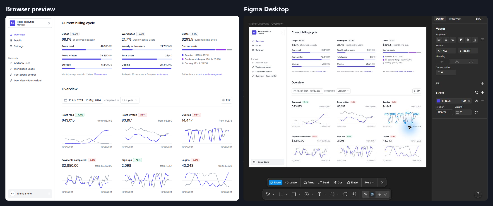

# FigBridge

**Import websites, app screens, PDFs and PowerPoint decks into Figma as editable layers.**

FigBridge connects a local CLI and MCP server to Figma Desktop. Bring source material into a design file, then inspect, edit, export or compare the resulting layers.

*The open-source Tremor dashboard, rendered from a local checkout. In Figma Desktop, the Queries series is selected in the layer tree and its vector anchor points are visible on the canvas. [Full-size comparison](docs/assets/web-import.png) · [Tremor source](https://github.com/tremorlabs/template-dashboard/tree/ac673531b124244b75fef5c750df1fa9ee783d4a) · [Web import guide](docs/web-import.md)*

## What you can do

| Workflow | Result |
| --- | --- |
| **Website capture** | Open live sites, follow links and explore UI states within set limits. Import pages, menus and other captured states as editable Figma layers. |
| **Reconstruct screens from source code** | Run a frontend from source, such as an open GitHub repository, and turn the rendered screens into editable Figma layers. |
| **PDF and PowerPoint** | Convert pages and slides into editable layers. PowerPoint tables and supported charts are rebuilt from native shapes, and Figma Slides imports preserve speaker notes. |
| **Figma automation** | Inspect or update layers, export frames, compare pixels and read native comments from an MCP client or the CLI. |

## Install with an assistant

Open a local session in **Codex** in the ChatGPT desktop app or **Code** in Claude Desktop. Send this message:

> Install FigBridge on this computer from https://github.com/vafaevelshodbek-png/FigBridge. Follow the assistant setup guide. Use local commands and leave the Figma clicks to me.

Your assistant prepares FigBridge and gives you the plugin file path. In Figma Desktop, import that file and open FigBridge. Paste the pairing token once when your assistant has copied it to your clipboard.

[Assistant setup guide](docs/first-import-check.md#assistant-setup) · [Manual setup for developers](docs/first-import-check.md#manual-setup)

## Explore the project

- [Web import](docs/web-import.md) and [PDF / PowerPoint import](docs/deck-import.md)
- [MCP setup and tool reference](docs/tools.md)
- [Architecture and package map](docs/ARCHITECTURE.md)
- [Security and permissions](SECURITY.md) and [contributing](CONTRIBUTING.md)

MIT licensed. Created by [Vafaev Elshodbek](https://github.com/vafaevelshodbek-png), building on the original Figma bridge by [strevesuksess](https://github.com/strevesuksess).
