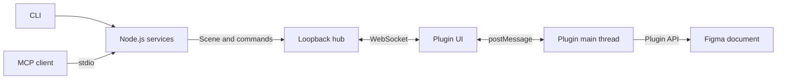

# Architecture

FigBridge has three runtime parts. A Node.js process exposes the CLI and MCP tools, a loopback hub routes requests and image assets, and a Figma Desktop plugin executes operations through the Plugin API. Web, PDF and PowerPoint importers share a Scene representation with the plugin.



## Package map

| Directory | Owns |
| --- | --- |
| [`packages/figbridge`](../packages/figbridge) | CLI, MCP tool catalog, hub, import orchestration, browser capture and local output files |
| [`packages/protocol`](../packages/protocol) | Wire envelopes, method schemas, access classifications and error codes |
| [`packages/scene`](../packages/scene) | Shared Scene schema, asset IDs and a reference rasterizer for tests |
| [`packages/import-pdf`](../packages/import-pdf) | PDF.js interpretation and conversion to Scene |
| [`packages/import-pptx`](../packages/import-pptx) | OOXML reading and conversion to Scene |
| [`packages/plugin`](../packages/plugin) | Figma transport, permission checks, document handlers and Scene rendering |
| [`corpus`](../corpus) | Redistributable test decks and golden images |
| [`examples`](../examples) | Runnable examples for people evaluating FigBridge |

The protocol package imports Scene schemas for methods that accept Scene nodes. Each document importer depends on Scene. The plugin shares both schemas, and the Node CLI bundles the private workspace packages into one installable package. [Package manifest and public exports](../packages/figbridge/package.json)

## Follow a request

1. The CLI or MCP tool validates input and picks a session. A local owner binds the hub on `127.0.0.1:7331` by default. Other processes can attach to the existing hub. [CLI](../packages/figbridge/src/cli.ts) · [MCP tools](../packages/figbridge/src/mcp/tools.ts) · [Runtime](../packages/figbridge/src/runtime.ts)
2. The plugin UI opens a WebSocket. The hub verifies the pairing token and negotiates a protocol version, then routes requests by session. Images and exports move as blobs, while the control messages use typed JSON envelopes. [Hub server](../packages/figbridge/src/hub/server.ts) · [Wire envelopes](../packages/protocol/src/envelope.ts) · [Method schemas](../packages/protocol/src/methods.ts)
3. The UI passes commands to the plugin main thread over `postMessage`. Its dispatcher enforces access, pause and approval rules before invoking a handler. The handler reads or changes Figma through the Plugin API. [Dispatcher](../packages/plugin/src/main/dispatcher.ts) · [Renderer](../packages/plugin/src/main/render/scene-renderer.ts)

Native comments follow a separate read path from Node.js to the Figma REST API. The plugin and hub do not receive the REST token. [Comments ADR](adr/0007-read-figma-comments.md)

## Follow an import

```text
PDF operators ─────┐
PowerPoint OOXML ──┼──> Scene + binary assets ──> Figma renderer
Chromium DOM/CSS ──┘
```

- **PDF.** Interpret PDF.js operators in paint order. Resolve text, vectors, images and clips, then group related primitives. [PDF entry point](../packages/import-pdf/src/import.ts)
- **PowerPoint.** Resolve slide, layout and master inheritance. Rebuild drawing geometry, styles, tables and supported charts from OOXML. [PowerPoint entry point](../packages/import-pptx/src/import.ts)
- **Web.** Use Chromium to measure DOM and CSS, collect resources and save reference screenshots. Capture can operate offline from Figma. Import rechecks the named file and session, then sends each captured Scene to the renderer. [Web orchestration](../packages/figbridge/src/web-import.ts) · [Browser adapters](../packages/figbridge/web) · [Workflow and limits](web-import.md)

Scene records geometry, paints, text and hierarchy. Capture JSON may embed asset data for reuse. Render requests resolve those assets into blob IDs. The Figma renderer creates native nodes and reports unsupported rendering or font substitutions. [Scene schema](../packages/scene/src/schema.ts)

## Verification and boundaries

CI runs on Linux, macOS and Windows. Parser tests use small generated fixtures. Golden tests compare reference raster output against versioned images. Integration tests exercise the hub, MCP and a test Figma API. Browser regression tests use Chromium. The packaging smoke test installs the tarball outside the workspace and checks the CLI, MCP and plugin bundle.

Live imports additionally exercise the actual Figma renderer, fonts and runtime API. Web captures preserve measured positions, while Auto Layout and inferred component or prototype relationships are outside the current web renderer.

[Contributing and verification commands](../CONTRIBUTING.md) · [Security model](../SECURITY.md) · [Architecture decisions](adr) · [Background research](research)
